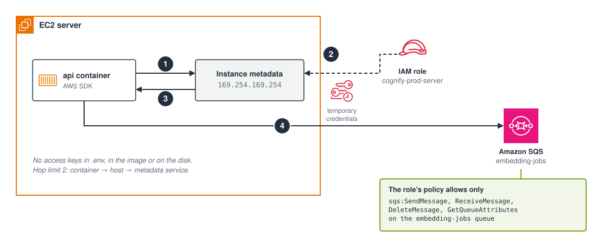

# Cognify Ops – AWS infrastructure

Terraform for [Cognify Ops](#what-it-runs), built **one small step at a time**.
Every step has a note that records what was built, why it was built that way,
and how to check it. The notes are the point of this repo as much as the code:
they are my working record of planning an AWS setup from an empty account.

**Start here:** [01 – CIDR plan](notes/network/01-cidr-plan.md)

## Contents

- [Build log](#build-log)
- [Notes](#notes)
- [The design](#the-design)
- [The address plan](#the-address-plan)
- [The EC2 server](#the-ec2-server)
- [Cost](#cost)
- [What it runs](#what-it-runs)
- [Repo layout](#repo-layout)
- [Running it](#running-it)

## Build log

Each row is one change, applied and checked before the next one starts.

| #  | Step | Note | Code | Status |
|----|------|------|------|--------|
| 01 | CIDR plan, VPC and subnets | [CIDR plan](notes/network/01-cidr-plan.md) | [modules/network](modules/network) | Applied |
| 02 | Remote state (S3 bucket, versioning, lock file) | [Remote state](notes/state/01-remote-state.md) | [bootstrap/state](bootstrap/state) | Applied |
| 03 | Internet gateway and public route table | [Internet access](notes/network/02-internet-access.md) | [modules/network](modules/network) | Applied |
| 04 | SQS queue and dead-letter queue | [The EC2 server, section 9](notes/compute/01-server.md#9-the-queue) | [modules/queue](modules/queue) | Applied |
| 05 | EC2 server: security group, IAM role, key pair, disk, Elastic IP | [The EC2 server](notes/compute/01-server.md) | [modules/server](modules/server) | Applied |
| 06 | Deploy the API, embedding worker and Postgres | [Deploying the API](notes/compute/02-deploying-the-api.md) | [scripts](scripts), [server](server) | Working |
| 07 | Frontend on Vercel, with `/api/*` rewritten to the server | – | [vercel.json](https://github.com/swopnilll/cognify-ops-fe/blob/main/vercel.json) | Working: [cognify-ops-fe.vercel.app](https://cognify-ops-fe.vercel.app) |
| 08 | HTTPS between Vercel and the server (needs a domain) | – | – | To do |
| 09 | Database backups | – | – | To do |
| 10 | Budget alert and monitoring | – | – | To do |

## Notes

**State**

- [01 – Remote state](notes/state/01-remote-state.md): what Terraform state is,
  why it lives in S3, locking, and the chicken-and-egg problem of creating the
  bucket.

**Network**

- [01 – CIDR plan](notes/network/01-cidr-plan.md): choosing the VPC range, the
  subnet numbering scheme, why two AZs for one server, and how `cidrsubnet()`
  computes it.
- [02 – Internet access](notes/network/02-internet-access.md): the internet
  gateway, route tables, and what actually makes a subnet public.

**Compute**

- [01 – The EC2 server](notes/compute/01-server.md): placement, Elastic IP,
  security group, instance type and OS, the encrypted disk, the SSH key pair
  and the IAM role.
- [02 – Deploying the API](notes/compute/02-deploying-the-api.md): building
  images on a laptop and running them on the server.

All diagrams are generated from code: see [diagrams/](diagrams).

## The design

The goal is the cheapest setup that still runs everything: one small EC2
instance for the backend, and the frontend on Vercel's free tier.


1. The user loads the React app from Vercel, over HTTPS.
2. The app calls `/api` on the same Vercel address. Vercel forwards those
   requests through the internet gateway to the `api` container, so the
   browser never makes a plain-HTTP call.
3. `api` reads and writes Postgres.
4. When a project or task is created, `api` publishes a job to SQS.
5. `embedding` long-polls the queue and picks the job up.
6. `embedding` writes the text chunks and their vectors to Postgres.
7. `api` and `embedding` call OpenAI for chat and embeddings.

Design rules:

- **No fixed monthly costs beyond the server.** No NAT gateway, no load
  balancer, no RDS. The subnets for them are reserved because that is free.
- **Everything in code.** Nothing is created in the console.
- **One change at a time.** Plan, apply, check, write the note, commit.
- **Account guard.** The provider has `allowed_account_ids`, so Terraform
  refuses to run against any account other than the intended one.
- **No stored AWS keys.** The server gets its permissions from an IAM role.

## The address plan

| Range     | CIDR          | AZ              | For                         |
|-----------|---------------|-----------------|-----------------------------|
| VPC       | 10.30.0.0/16  | –               |                             |
| public-a  | 10.30.0.0/24  | ap-southeast-2a | The EC2 server              |
| public-b  | 10.30.1.0/24  | ap-southeast-2b | Empty, reserved             |
| private-a | 10.30.10.0/24 | ap-southeast-2a | Empty, reserved             |
| private-b | 10.30.11.0/24 | ap-southeast-2b | Empty, reserved             |


The reasoning behind every number is in the [CIDR plan](notes/network/01-cidr-plan.md).
How public-a reaches the internet is in [Internet access](notes/network/02-internet-access.md).

## The EC2 server

One instance runs the whole backend as three Docker containers: the API, the
embedding worker and Postgres. This section is the summary. The full
explanation of each part is in [The EC2 server](notes/compute/01-server.md).


| # | Part | Choice | Why |
|---|------|--------|-----|
| 1 | Placement | Subnet public-a, ap-southeast-2a | It needs the internet both ways. A private subnet would need a NAT gateway |
| 2 | Address | Elastic IP | A fixed public address that survives stop/start and replacement |
| 3 | Firewall | Security group: 80 and 443 from anyone, 22 from one IP | Only the web ports are public |
| 4 | Machine and OS | t4g.micro (2 vCPU, 1 GB, ARM), Ubuntu Server 24.04 LTS | Cheapest size that runs the stack. LTS has security updates to 2029 |
| 5 | Disk | 16 GB gp3 EBS volume, encrypted | Holds the OS, images and the database. Can grow later, never shrink |
| 6 | Login | SSH key pair (ed25519) | No passwords. The private key never leaves my laptop |
| 7 | Permissions | IAM role with four SQS actions on one queue | No access keys stored on the server |

### 1. Why public-a

The server is the only thing in the VPC, and it sits in the public subnet in
the first availability zone. Being "public" takes three things together: a
route from the subnet to the internet gateway, a public IP address, and a
security group rule that lets traffic in. Take any one away and the server is
unreachable.

It also has a private address from the subnet's range, 10.30.0.x, which is the
only address the instance itself knows about. The internet gateway translates
between the private and the public one.

### 2. Elastic IP

An ordinary public IP is borrowed and changes when the instance is stopped and
started. An Elastic IP belongs to the account until it is released, so the
API's address never changes. When the instance was resized by replacing it,
the same address moved to the new one.

Every public IPv4 address on AWS costs about US$3.65 a month, Elastic or not.

### 3. Security group


1. **HTTP (80) and HTTPS (443) from anyone.** The API listens on 80. Nothing
   listens on 443 until there is a certificate.
2. **SSH (22) from one IP address only**, written as a `/32`. The Terraform
   module refuses `0.0.0.0/0` for SSH.
3. **Everything else is dropped.** A security group only has allow rules, so
   there is nothing to deny explicitly. Postgres is not reachable from outside.
4. **All outbound traffic is allowed**, for package installs, image pulls, SQS
   and OpenAI.

Security groups are **stateful**: the reply to an allowed request is always
let through, so replies need no rules of their own.

### 4. Instance type and operating system

- **t4g.micro**: 2 vCPUs, 1 GB of memory, on AWS's ARM (Graviton) processors,
  which are about 20% cheaper than the same size on Intel.
- **1 GB is enough because the server never builds anything.** Docker images
  are built on a laptop and loaded onto it. Running, the stack uses about
  430 MB. A 2 GB swap file is the safety net.
- **Burstable, in standard mode.** A `t` instance earns CPU credits while idle
  and spends them when busy. Out of credits, this one slows down instead of
  billing extra.
- **Ubuntu Server 24.04 LTS, arm64.** Five years of security updates, and
  Docker publishes official packages for it. The AMI ID is read from a public
  SSM parameter that Canonical keeps up to date, not hard-coded.
- **First boot** runs a script that adds swap and installs Docker.
- **IMDSv2 only**, which blocks a common way of stealing instance credentials.

### 5. The disk: 16 GB, gp3, encrypted

- It is an **EBS volume**: network storage that exists apart from the physical
  host. If the host fails, the volume and its data move to a new one.
- **gp3** is the general-purpose SSD type, with 3,000 IOPS and 125 MB/s
  included at any size.
- **16 GB**: about 6.5 GB used by the OS, swap and images, the rest for the
  database. A volume can be grown without downtime but never shrunk, so it
  starts small.
- **Encrypted**: data is encrypted before it reaches the drive, with a key held
  in AWS KMS. The server sees an ordinary disk. It is free and has no
  noticeable speed cost. It protects the drive and any snapshot of it. It does
  not protect against someone who has logged in to the server.

The database lives on this one volume, and there are **no backups yet**.

### 6. SSH key pair

The server holds only the **public** half of a key pair. Logging in proves
possession of the private half, which stays on my laptop, without sending
anything secret. Password login is off.

### 7. IAM role



1. The AWS SDK in the container asks the instance metadata service for
   credentials.
2. AWS issues temporary credentials for the instance's role and rotates them
   every few hours.
3. The SDK receives them. Nothing is written to disk.
4. Requests to SQS are signed with them and checked against the role's policy.

The policy allows four SQS actions on one queue and nothing else. The role
also allows Session Manager, a shell through the AWS console with no open port,
as a fallback if SSH is unavailable.

## Cost

| Item | About, per month |
|---|---|
| EC2 t4g.micro | US$7.70 |
| 16 GB gp3 disk | US$1.50 |
| Public IPv4 address | US$3.65 |
| SQS, VPC, IAM, state bucket | under US$0.10 |
| **Total** | **about US$13** |

Approximate Sydney on-demand prices. Check the AWS Pricing Calculator.

## What it runs

Cognify Ops is a project management web app: projects, a Kanban board, and an
AI assistant that answers questions from the project's own data (RAG).

| Repo | What it is | Runs on |
|------|------------|---------|
| [cognify-ops-api](https://github.com/swopnilll/cognify-ops-api) | REST API (Express, Prisma, PostgreSQL) | The EC2 server |
| [embedding-microservice](https://github.com/swopnilll/embedding-microservice) | Worker that builds the knowledge base | The EC2 server |
| [cognify-ops-fe](https://github.com/swopnilll/cognify-ops-fe) | React frontend | [Vercel](https://cognify-ops-fe.vercel.app) |

## Repo layout

```
main.tf                    Backend, provider, and one module call per building block
variables.tf               Inputs: account ID, CLI profile, SSH key, SSH source IPs
outputs.tf                 Server address, API URL, queue URL
terraform.tfvars.example   Copy to terraform.tfvars (git-ignored)
bootstrap/
  state/                   The S3 bucket for Terraform state. Applied once
modules/
  network/                 VPC, subnets, internet gateway, public route table
  queue/                   SQS queue with a dead-letter queue
  server/                  EC2 instance, security group, IAM role, key pair, Elastic IP
server/
  docker-compose.yml       What runs on the server
  .env.example             Copy to server/.env.prod (git-ignored)
scripts/
  deploy-api.sh            Builds the images and deploys them to the server
notes/                     One note per step
diagrams/
  build.py                 Generates every diagram: python3 diagrams/build.py
  icons/                   AWS Architecture Icons used by build.py
  *.svg                    The generated diagrams
```

## Running it

Needs Terraform 1.15, Docker, and an AWS CLI profile for the target account.

```bash
# 1. Infrastructure
cp terraform.tfvars.example terraform.tfvars   # account ID, SSH public key, your IP
terraform init
terraform plan
terraform apply

# 2. Application
cp server/.env.example server/.env.prod        # database password, JWT secret, OpenAI key
scripts/deploy-api.sh

# 3. Check
curl "$(terraform output -raw api_url)/health"
```

In a new account, apply `bootstrap/state` first and put your own bucket name in
both `backend "s3"` blocks. See [Remote state](notes/state/01-remote-state.md).

The CIDR maths can be checked without an AWS account:

```bash
echo 'cidrsubnet("10.30.0.0/16", 8, 10)' | terraform console
# "10.30.10.0/24"
```
