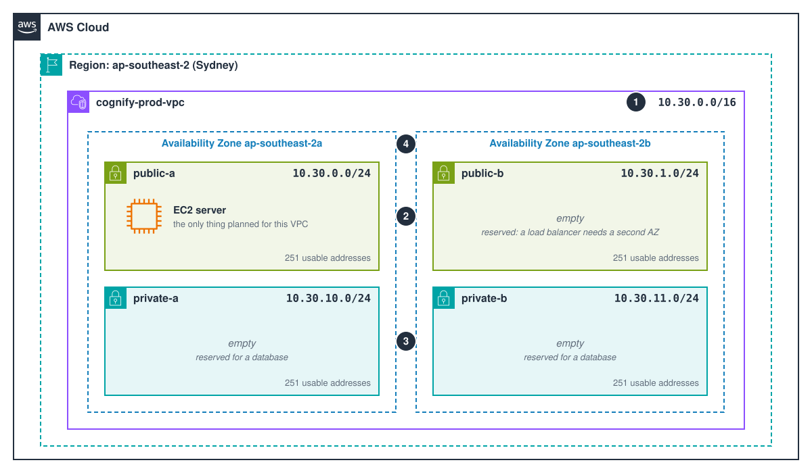
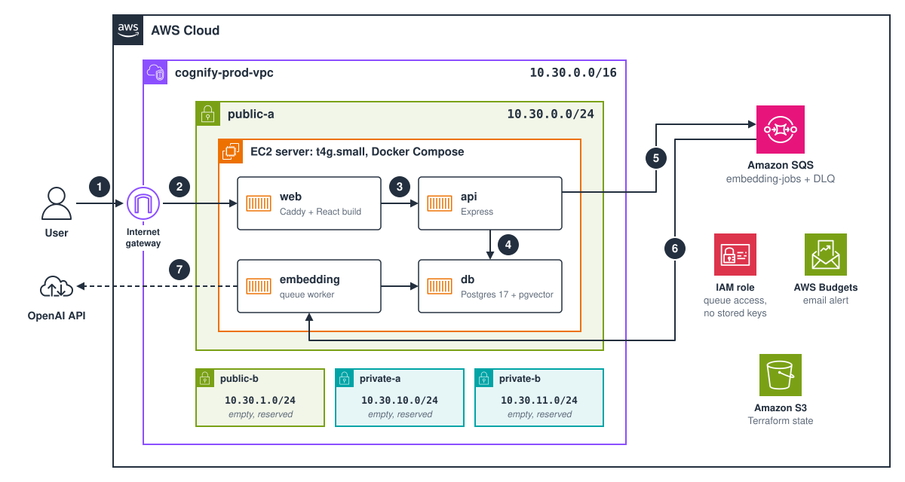

# Cognify Ops – AWS infrastructure

Terraform for [Cognify Ops](#what-it-runs), built **one small step at a time**.
Every step has a note that records what was built, why it was built that way,
and how to check it. The notes are the point of this repo as much as the code:
they are my working record of planning an AWS setup from an empty account.

**Start here:** [01 – CIDR plan](notes/network/01-cidr-plan.md)

## Build log

Each row is one change, applied and checked before the next one starts.

| #  | Step | Note | Code | Status |
|----|------|------|------|--------|
| 01 | CIDR plan, VPC and subnets | [notes/network/01-cidr-plan.md](notes/network/01-cidr-plan.md) | [modules/network](modules/network) | Planned, not applied |
| 02 | Remote state (S3 bucket, versioning, lock file) | – | – | Next |
| 03 | Internet gateway | – | – | To do |
| 04 | Public route table | – | – | To do |
| 05 | Security group for the server | – | – | To do |
| 06 | EC2 server, Elastic IP, IAM role | – | – | To do |
| 07 | SQS queue and dead-letter queue | – | – | To do |
| 08 | Budget alert | – | – | To do |

## Notes

**Network**

- [01 – CIDR plan](notes/network/01-cidr-plan.md): choosing the VPC range, the
  subnet numbering scheme, why two AZs for one server, and how `cidrsubnet()`
  computes it. Diagrams:
  [the plan](diagrams/01-address-plan.svg) ·
  [choosing the range](diagrams/01-choosing-the-range.svg) ·
  [reading an address](diagrams/01-reading-an-address.svg) ·
  [used and free space](diagrams/01-address-space.svg) ·
  [reserved addresses](diagrams/01-reserved-addresses.svg)

More are added as each step is built.

## The address plan at a glance

| Range     | CIDR          | AZ              | For                         |
|-----------|---------------|-----------------|-----------------------------|
| VPC       | 10.30.0.0/16  | –               |                             |
| public-a  | 10.30.0.0/24  | ap-southeast-2a | The EC2 server              |
| public-b  | 10.30.1.0/24  | ap-southeast-2b | Empty, reserved             |
| private-a | 10.30.10.0/24 | ap-southeast-2a | Empty, reserved             |
| private-b | 10.30.11.0/24 | ap-southeast-2b | Empty, reserved             |



The reasoning behind every number is in the [CIDR plan](notes/network/01-cidr-plan.md).

## What it runs

Cognify Ops is a project management web app: projects, a Kanban board, and an
AI assistant that answers questions from the project's own data (RAG).

| Repo | What it is |
|------|------------|
| [cognify-ops-fe](https://github.com/swopnilll/cognify-ops-fe) | React frontend |
| [cognify-ops-api](https://github.com/swopnilll/cognify-ops-api) | REST API (Express, Prisma, PostgreSQL) |
| [embedding-microservice](https://github.com/swopnilll/embedding-microservice) | Worker that builds the knowledge base |

## Target design

The goal is the cheapest setup that still runs everything: one EC2 instance
running Docker Compose, about US$22 a month.



1. The user's browser connects to the server's Elastic IP.
2. The internet gateway passes the request into public-a, where `web` (Caddy)
   serves the React app.
3. Caddy proxies `/api/*` to `api`.
4. `api` reads and writes Postgres.
5. When a project or task is created, `api` publishes a job to SQS.
6. `embedding` long-polls the queue, then writes the chunks and their vectors
   to Postgres. The IAM role gives both containers queue access with no stored
   keys.
7. `embedding` and `api` call OpenAI for embeddings and chat.

Only the VPC and subnets exist in code so far. See the [build log](#build-log).

Design rules:

- **No fixed monthly costs beyond the server.** No NAT gateway, no load
  balancer, no RDS. The subnets for them are reserved because that is free.
- **Everything in code.** Nothing is created in the console.
- **One change at a time.** Plan, apply, check, write the note, commit.
- **Account guard.** The provider has `allowed_account_ids`, so Terraform
  refuses to run against any account other than the intended one.

## Repo layout

```
main.tf                    Provider, and one module call per building block
variables.tf               Account ID and CLI profile
terraform.tfvars.example   Copy to terraform.tfvars (git-ignored)
modules/
  network/                 VPC and subnets
notes/
  network/                 One note per step
diagrams/
  build.py                 Generates every diagram: python3 diagrams/build.py
  icons/                   AWS Architecture Icons used by build.py
  *.svg                    The generated diagrams
```

## Running it

Needs Terraform 1.15 and an AWS CLI profile for the target account.

```bash
cp terraform.tfvars.example terraform.tfvars   # set aws_account_id
terraform init
terraform plan -var aws_profile=<your-profile>
```

The CIDR maths can be checked without an AWS account:

```bash
echo 'cidrsubnet("10.30.0.0/16", 8, 10)' | terraform console
# "10.30.10.0/24"
```
