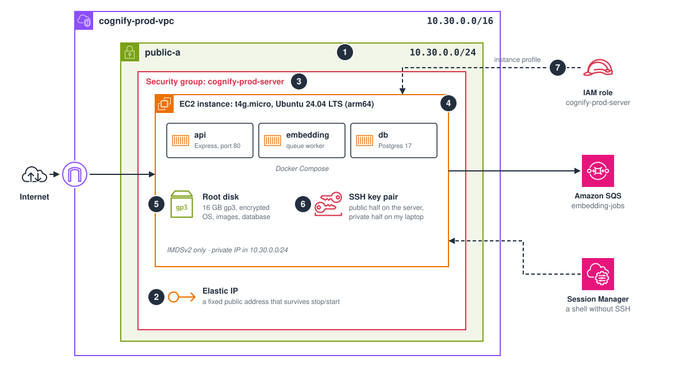
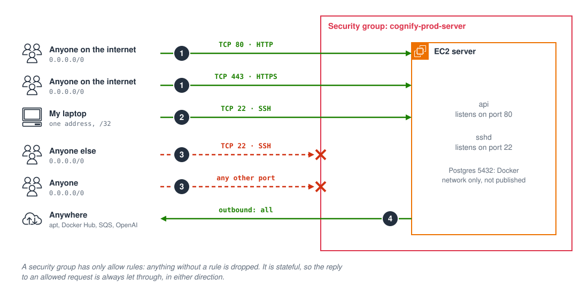
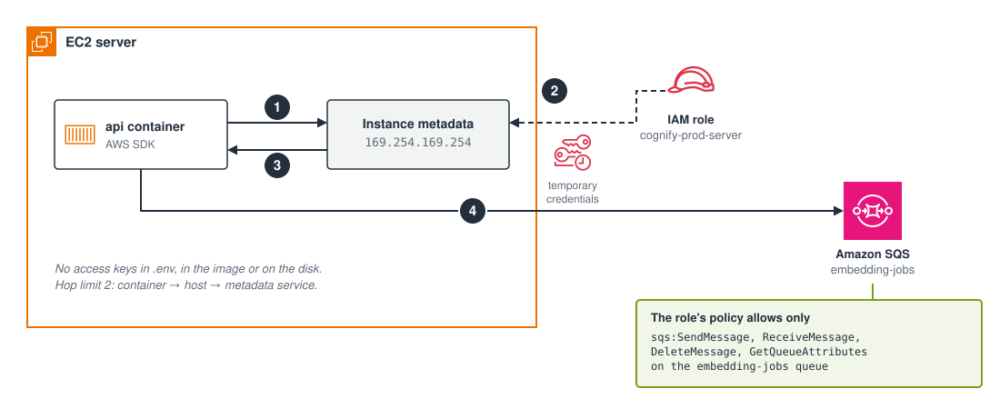

# 01 – The EC2 server

[← Back to the README](../../Readme.md)

One EC2 instance that runs the whole backend: the API, the embedding worker
and Postgres, as three Docker containers.

Status: **applied and serving.** Code: [`modules/server`](../../modules/server),
[`modules/queue`](../../modules/queue).

---

## 1. The picture

1. [Placement: public-a](#2-placement-public-a)
2. [Elastic IP](#3-elastic-ip)
3. [Security group](#4-security-group)
4. [Instance type and operating system](#5-instance-type-and-operating-system)
5. [Root disk](#6-root-disk-16-gb-gp3-encrypted)
6. [SSH key pair](#7-ssh-key-pair)
7. [IAM role](#8-iam-role)

## 2. Placement: public-a

The instance is in **public-a** (10.30.0.0/24, ap-southeast-2a). It has to be
in a public subnet because it needs the internet in both directions:

- **In:** users reach the API.
- **Out:** it pulls packages and Docker images, and calls SQS and OpenAI.

A private subnet would need a NAT gateway for the outbound half (about US$45 a
month). See [02 – Internet access](../network/02-internet-access.md).

The trade-off: the instance is directly on the internet, so the security group
is the only thing between it and everyone else.

It also has a **private IP** from the subnet's range (10.30.0.x), picked by
AWS. That address never leaves the VPC.

## 3. Elastic IP

A normal public IP is borrowed: stop and start the instance and it gets a
different one. An **Elastic IP** is an address the account owns until it is
released, so the API's address stays the same through stop/start, a resize, or
a replacement of the instance.

- The address belongs to the Elastic IP, not the instance. Terraform
  re-attached the same address when the instance was replaced.
- **Cost:** every public IPv4 address costs about US$3.65 a month, attached or
  not. The Elastic IP costs the same as an ordinary public address.
- The instance itself only knows its private IP. The internet gateway
  translates between the two.

## 4. Security group

A security group is a firewall around the instance's network interface.

| Direction | Port | From / to | Why |
|---|---|---|---|
| In | TCP 80 | 0.0.0.0/0 | The API |
| In | TCP 443 | 0.0.0.0/0 | HTTPS, once there is a certificate. Nothing listens yet |
| In | TCP 22 | one address, /32 | SSH for deploys, from my IP only |
| Out | everything | 0.0.0.0/0 | Packages, images, SQS, OpenAI |

1. **Open to everyone:** only the web ports.
2. **Open to one address:** SSH. A `/32` is a single IP. The module refuses
   `0.0.0.0/0` for SSH (a `validation` block), so it can't be opened to the
   world by accident.
3. **Blocked:** everything else. There is no "deny" rule to write. A security
   group only has allow rules, and whatever is not allowed is dropped.
4. **Outbound:** all allowed.

Things worth knowing:

- **Stateful.** If a request is allowed in, its reply is allowed out
  automatically, and the other way round. That is why there is no inbound rule
  for the replies to the server's own outbound calls.
- **Postgres (5432) is not reachable from outside twice over.** No rule allows
  it, and the container doesn't publish the port to the host either.
- **Rules are separate resources** (`aws_vpc_security_group_ingress_rule`), not
  inline blocks, so one rule can be changed without touching the others.
- If my home IP changes, SSH stops working until `ssh_allowed_cidrs` is updated
  and applied. Session Manager (section 8) still works.

## 5. Instance type and operating system

**t4g.micro**: 2 vCPUs, 1 GB of memory, ARM (AWS Graviton).

- **ARM** instances are about 20% cheaper than the same size on Intel. The
  images are built on an ARM laptop, so they run natively.
- **1 GB is enough because the server never builds anything.** Images are
  built on a laptop and loaded onto it. Running: about 430 MB used.
- **Burstable.** A `t` instance earns CPU credits while idle and spends them
  when busy. T4g instances launch in *unlimited* mode, which bills extra when
  credits run out. This one is set to **standard**: it slows down instead, so
  the bill can't surprise.
- **2 GB of swap** is added on first boot as a safety net: a memory spike makes
  the server slow instead of killing a container.

**Ubuntu Server 24.04 LTS (arm64)**

- **LTS** = five years of security updates (to 2029).
- Docker publishes official packages for it.
- The AMI ID is not hard-coded. Canonical publishes the current one in a public
  SSM parameter, which Terraform reads:
  `/aws/service/canonical/ubuntu/server/24.04/stable/current/arm64/hvm/ebs-gp3/ami-id`
- `ignore_changes = [ami, user_data]`: a newer Ubuntu image must **not**
  replace the server, because the database is on its disk. Updates are applied
  with `apt` on the running instance.

**First boot** (`user_data.sh`, run once by cloud-init): adds the swap file,
installs Docker with the Compose plugin, creates `/opt/cognify`.

**IMDSv2 only** (`http_tokens = "required"`): the metadata service needs a
session token, which blocks a common way of stealing instance credentials
through a server-side request forgery bug.

## 6. Root disk: 16 GB gp3, encrypted

The disk is an **EBS volume**: network-attached storage that exists separately
from the instance's hardware. If the host fails, the volume is attached to a
new one with its data intact.

- **gp3** is the current general-purpose SSD type: 3,000 IOPS and 125 MB/s
  included, whatever the size. Cheaper than the older gp2.
- **16 GB** holds the OS (about 3 GB), the swap file (2 GB), Docker images
  (about 1.5 GB) and the database. About 8 GB is free. A volume can be grown
  later without downtime, but **never shrunk**, so it starts small.
- **Encrypted.** Data is encrypted before it is written, using a key held in
  AWS KMS (the AWS-managed `aws/ebs` key). The instance sees a normal disk.
  It costs nothing and has no measurable speed cost. It protects the data on
  the physical drive and in any snapshot taken of the volume.
- Encryption protects against someone getting the disk, not against someone
  getting into the server. A logged-in user reads the data as usual.

**The risk here:** the database lives on this one volume, and the volume is
deleted if the instance is terminated. There are no backups yet.

## 7. SSH key pair

SSH logs in with a key pair instead of a password.

- The **private key** stays on my laptop (`~/.ssh/id_ed25519`). It never leaves.
- The **public key** is given to AWS as an EC2 key pair. On first boot it is
  written to `/home/ubuntu/.ssh/authorized_keys`.
- At login the server sends a challenge that only the private key can answer.
  Nothing secret crosses the network.
- Password login is off in the Ubuntu image, so there is nothing to guess.

The public key goes in `terraform.tfvars`, which is git-ignored. A public key
is not a secret, but it does identify a person.

## 8. IAM role

The API and the worker need to use SQS. The usual shortcut is an access key in
`.env`, which never expires and works from anywhere if it leaks. A role avoids
that:

1. The AWS SDK in the container asks the **instance metadata service**, a
   special address reachable only from the instance.
2. AWS hands out **temporary credentials** for the instance's role and rotates
   them every few hours.
3. The SDK gets the credentials. Nothing is stored on disk.
4. The request to SQS is signed with them. SQS checks the role's policy.

The pieces:

- **Role** `cognify-prod-server`, which only the EC2 service can assume.
- **Instance profile**: the wrapper that attaches a role to an instance.
- **Policy, least privilege:** four SQS actions on one queue. Nothing else in
  the account.
- **Hop limit 2.** A container is one network hop behind the host. The default
  limit of 1 would stop it reaching the metadata service.
- **Session Manager** (`AmazonSSMManagedInstanceCore`): a shell from the AWS
  console or CLI with no open port and no key, as a fallback for SSH.

## 9. The queue

`modules/queue` creates `embedding-jobs` and a dead-letter queue.

- The API sends a job when a project or task is created. The worker long-polls
  (waits up to 20 seconds for a message), which keeps empty requests and cost
  down.
- A received message is hidden for 120 seconds. If the worker doesn't delete it
  in time, it becomes visible again and is retried.
- After 3 failed attempts it moves to `embedding-jobs-dlq`, where it is kept
  for 14 days to be looked at.

## 10. Cost

| Item | About, per month |
|---|---|
| t4g.micro | US$7.70 |
| 16 GB gp3 | US$1.50 |
| Public IPv4 address | US$3.65 |
| SQS, VPC, IAM, state bucket | under US$0.10 |
| **Total** | **about US$13** |

Approximate Sydney on-demand prices. Check the AWS Pricing Calculator.

## 11. What is missing

- **HTTPS.** The API is plain HTTP on an IP address. A certificate needs a
  domain name.
- **Backups.** Nothing protects the database if the volume or instance is lost.
- **Monitoring and alerts.** No alarms, no budget alert.
- **Automatic security updates** are on in Ubuntu by default, but nobody is
  told when a reboot is needed.
