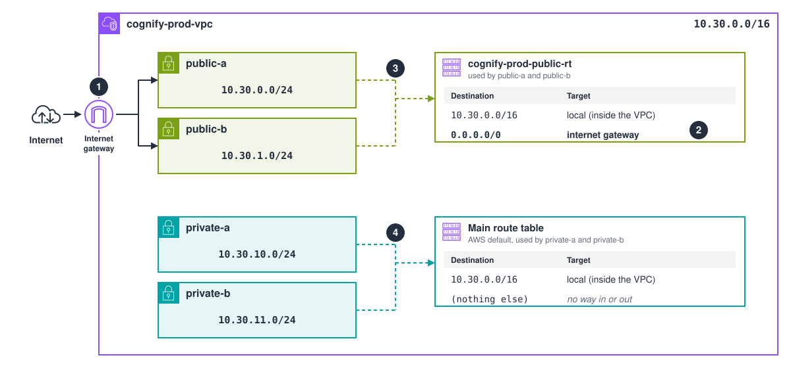

# 02 – Internet access

[← Back to the README](../../Readme.md)

What turns a subnet into a *public* subnet. After [01 – CIDR plan](01-cidr-plan.md)
the four subnets were only address ranges with labels. This step gives two of
them a way to reach the internet.

Status: **applied.** Code: [`modules/network`](../../modules/network).

---

## 1. The picture



1. **Internet gateway.** The door between the VPC and the internet. One per
   VPC. It is free and has no capacity limit to manage.
2. **The default route.** `0.0.0.0/0 → internet gateway` means "anything that
   is not inside the VPC goes out through the gateway". This single route is
   what makes a subnet public.
3. **Association.** A route table does nothing until a subnet is associated
   with it. public-a and public-b are associated with the public route table.
4. **Private subnets are left alone.** A subnet with no association uses the
   VPC's **main route table**, which AWS creates with only the local route.
   They can talk inside the VPC and nowhere else.

## 2. How a route table is read

For each packet leaving a subnet, AWS picks the **most specific** matching
route (the longest prefix):

| Packet going to | Matches | Goes to |
|---|---|---|
| 10.30.10.57 | 10.30.0.0/16 (more specific than 0.0.0.0/0) | local: delivered inside the VPC |
| 8.8.8.8 | 0.0.0.0/0 only | the internet gateway |

The `local` route is added by AWS to every route table and can't be removed.

## 3. Three things needed to be reachable from the internet

A route to the gateway is necessary, but not enough. An instance needs all of:

1. **A subnet whose route table has `0.0.0.0/0 → internet gateway`.** This step.
2. **A public IP address.** The gateway translates between the instance's
   private address and its public one (one-to-one NAT). No public address, no
   translation. The server gets an Elastic IP in the next step.
3. **A security group rule that allows the traffic in.** Also the next step.

## 4. Decisions

- **No NAT gateway.** A NAT gateway lets *private* subnets start outbound
  connections. It costs about US$45 a month before any traffic, which is more
  than everything else here combined. Nothing runs in the private subnets, so
  there is nothing for it to serve.
- **Subnets don't hand out public IPs automatically**
  (`map_public_ip_on_launch` is off). Anything that needs one has to ask for
  it. A forgotten test instance then stays unreachable by default.
- **Separate `aws_route` resource** instead of an inline `route {}` block, so
  routes can be added later without rewriting the table.

## 5. Check it

```bash
aws ec2 describe-route-tables \
  --filters Name=tag:Name,Values=cognify-prod-public-rt \
  --query 'RouteTables[0].Routes[].[DestinationCidrBlock,GatewayId]' --output table
```

Expect two rows: `10.30.0.0/16 → local` and `0.0.0.0/0 → igw-…`.
